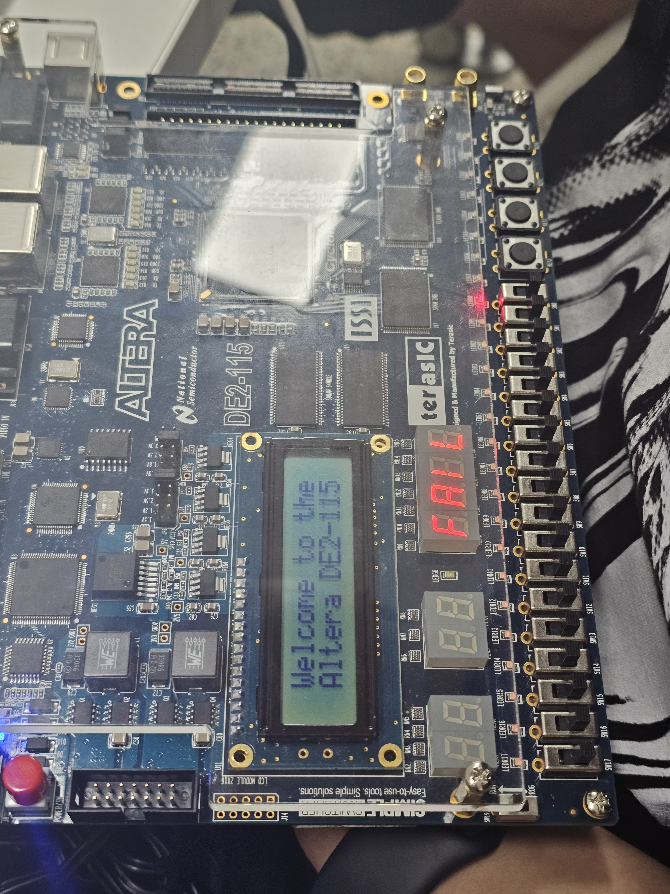

# FPGA Password Lock: RTL Simulation Review

A course-based Verilog password-lock design, originally implemented and tested on an Intel Cyclone IV FPGA board, revisited through RTL simulation to investigate why a design that worked on hardware did not progress in an uninitialized RTL simulation.

This repository documents a small design-and-verification exercise: identifying two independent simulation issues, making initialization and reset behavior explicit, and checking the revised functionality. It does **not** claim a hardware performance improvement or a failure observed on the original board.

## Original design

The original implementation was written by Jaejun Lee for a Digital System Design course in May 2025. It includes the authentication FSM, a clock divider, a blinking display module, and a seven-segment decoder. The author reports that it operated successfully on the FPGA board at the time.

- Four slide switches, `SW[3:0]`, select one hexadecimal digit.
- Active-low buttons `KEY[3]` through `KEY[0]` confirm the four digits in order.
- The entered password is compared with `16'h01AF`.
- LEDs and seven-segment displays indicate PASS or FAIL.
- A switch-change condition starts entry from IDLE.
- An ERROR state provides an RTL recovery path for undefined state values.

The assignment already required the FSM, four-digit entry, blinking feedback, PASS/FAIL output, and a timeout. These are implemented features, not claimed as original inventions. The switch-change start condition and ERROR recovery path extend the stated assignment behavior.

The course handout contained conflicting success-state descriptions: one stated that success persists until reset, while the detailed FSM routed both success and failure through a timed STOP state. This implementation follows the detailed FSM. The course handout is not redistributed here.

## Why hardware operation and RTL simulation differed

### 1. Incomplete sensitivity list

The original next-state block reads switches, buttons, password data, and counters, but only lists `state` as a triggering signal:

```verilog
always @(state) begin
    case (state)
        ST_IDLE: next_state = (initial_sw != SW) ? ST_INPUT0 : ST_IDLE;
        // ...
    endcase
end
```

In RTL simulation, a switch-only change does not execute this block. If the FSM remains in IDLE, `next_state` can stay stale indefinitely. Clock edges that write the same state value do not trigger a state-value change.

Synthesis can implement the described comparisons and selections as combinational logic that responds to its physical inputs. This explains how the original could operate on the board despite a different RTL simulation behavior. The historical synthesis netlist was not examined in this review.

The revision uses `always @*`. The state register still updates only on the divided-clock edge, except for its asynchronous reset. This change aligns the RTL description with the intended combinational next-state logic; it is not evidence of a faster hardware implementation.

### 2. Unspecified startup values

The original divided-clock counter and output, the switch-baseline register, and blinking registers lack explicit initialization/reset paths. Four-state RTL simulation starts these registers at `X`; arithmetic and inversion can preserve that unknown value.

An RTL `X` is not a physical third logic level and does not prove that the board clock stopped. FPGA configuration/power-up behavior can establish known register values. In this particular divider, assuming stable binary register values and a valid input clock, different startup values can affect the first transition and phase while still leading to periodic division. The exact historical Quartus power-up settings were not verified.

Other registers have different consequences: the initial switch baseline affects entry behavior, not just clock phase. Power-up initialization and pressing the user reset switch are also distinct operations.

## Revision scope

| Change | Purpose |
| --- | --- |
| `always @*` for next-state logic | Remove stale next-state evaluation in RTL simulation |
| Explicit reset for divider, display pipeline, and control/data registers | Allow deterministic simulation following reset |
| New `ST_INIT` state | Capture the current switch setting once after reset, then enter IDLE |
| Timing parameters | Shorten simulation while retaining the original default timing constants |

`ST_INIT` is an explicit behavior choice, not merely a sensitivity-list fix: reset now establishes the current switch position as the baseline. The next switch change starts entry. The user does not have to return all switches to zero.

The revision retains the original per-state button mapping, level-sensitive button checks, divided-clock architecture, and display pipeline. The internal divided-clock name remains `clk_1ms`, even when parameters accelerate it in tests.

## Verification experiments

| Testbench | Conditions and purpose | Result |
| --- | --- | --- |
| `tb_original` | First observes startup unknowns without seeding; then applies a test clock and selected internal values to isolate the sensitivity-list issue | Both diagnostic observations reproduced |
| `tb_improved` | Reduced timing parameters; success/failure, output patterns, timeout/re-entry, mid-entry reset, previous-button toggling, and RTL illegal-state injection | 41 dynamic check points passed |
| `tb_compare` | Shared external inputs and forced 80 ns internal clock for both designs; original startup registers explicitly seeded | 10 comparison check points passed |

These counts are check points, not 41 or 10 independent scenarios, and are not functional coverage percentages.

### Common-input comparison

The original and revised instances receive the same `01AF` and `01AE` switch/button sequences. The original remains in IDLE; the revised instance reaches PASS and FAIL respectively.

**This is a controlled sensitivity-list demonstration.** Both internal divided clocks are overridden, and original startup registers are seeded by the testbench. The original RTL source is not edited. This experiment does not compare the clock dividers, establish synthesis equivalence, or reproduce an observed FPGA-board failure. The original never reaches authentication in this experiment, so its authentication path is not evaluated by that comparison.

### Waveform evidence

The following PDFs were exported from the author's ModelSim runs:

- [Original diagnostic](docs/waveforms/original-diagnostic.pdf)
- [Revised startup and entry](docs/waveforms/revised-startup.pdf)
- [Revised functional scenarios](docs/waveforms/revised-functional.pdf)
- [Common-input comparison](docs/waveforms/common-input-comparison.pdf)

Text logs from the Icarus runs are in [docs/logs](docs/logs).

## Original Hardware Demonstration

Photos taken during the original course project.
These show the original RTL running on the FPGA board.
The revised RTL has been verified in simulation only.



## Reproduce in ModelSim

The author compiled and ran all three supplied testbenches in ModelSim Intel FPGA Starter Edition 10.5b. The `compare.do` script was used for the common-input comparison. Additional convenience scripts `improved.do` and `original.do` are provided but have not been independently rerun in ModelSim as scripts.

Open ModelSim in this repository's root directory. For a new working library:

```tcl
vlib work
vmap work work
file mkdir results
```

Choose one experiment:

```tcl
do improved.do
```

or:

```tcl
do original.do
```

or:

```tcl
do compare.do
```

Each script compiles the required sources, loads its testbench, adds signals, and runs the first 1 us. To complete:

```tcl
run -all
wave zoom full
```

If a finish dialog appears, keep the simulator open to inspect the waveforms. Before changing experiments, use `quit -sim`. A saved Wave Format `.do` file preserves display configuration; it is not a substitute for source files or recorded simulation data.

## Reproduce with Icarus Verilog

Requires Icarus Verilog and Bash. Tested with Icarus Verilog 12.0:

```bash
bash run.sh
```

The script runs all three experiments and writes logs to `results/`. The first two testbenches also write VCD files. Generated simulator data is ignored by Git; small reference text logs are intentionally retained under `docs/logs/`.

## Limitations and next steps

- The original was board-tested historically; the revised version has only been RTL-simulated. No new FPGA hardware test, Quartus synthesis, resource measurement, or timing analysis was performed.
- Reduced timing tests do not measure the default 1 ms divider period, 250 ms blinking interval, or 3 s timeout. Exact timing/duty-cycle verification remains future work.
- No input synchronizers, general debouncer, multi-bit switch-stability filter, or reset-release synchronizer were added.
- Different input states observe different buttons, so toggling a previous button need not advance the next state. This is not a general debounce solution. An already-held next button can still advance the FSM.
- Illegal-state forcing checks RTL behavior only. Synthesis may recode or optimize the FSM; physical upset recovery was not established.
- This is not exhaustive/formal verification. A hard-coded password demonstration is not a secure authentication product.

## Authorship and assistance

- **Original RTL and historical board implementation:** Jaejun Lee, with AI-assisted discussion while learning FSM design.
- **2026 review:** Jaejun revisited the code, discussed design intent and limitations, and executed/inspected ModelSim simulations.
- **AI-assisted contributions:** revised RTL, testbench and script generation, initial Icarus simulation, and documentation drafting. These contributions are distinguished from the original student implementation.

The original `.v` file in this repository was reconstructed from the author's code PDF, removing page headers and line numbers; some wrapped comment continuations were omitted. The original PDF is not included in the public-facing package. The recovered pin assignments are provided as a reference, not as a newly verified board project.
